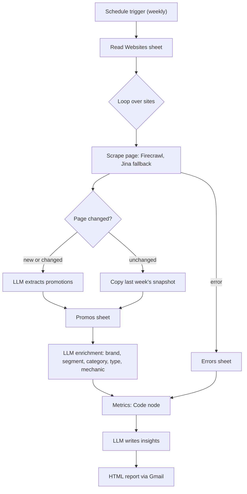

# Competitor Promo Intelligence: an n8n AI agent for beauty retail

English | [Русский](README.ru.md)

A weekly agent that watches the promotion pages of beauty retailers, turns them into a structured database, and emails a ready-to-read competitive intelligence report. It is a pet project built to show what an AI agent can do for a brand or category manager.

Tested on three Russian retailers (RIV GOSH, Letual, Gold Apple) over two weekly snapshots.

## What it does

Every week the agent:

1. **Parses** each competitor's promotions page and detects whether it changed since last week.
2. **Extracts** promotions from changed pages with an LLM (title, discount, deadline, products).
3. **Enriches** every promotion with a classification: brand, price segment, product category, promotion type, mechanic, duration.
4. **Reports** what changed week over week and sends an HTML email with tables, a chart and written insights.

### The report contains

- Key takeaways, threats and opportunities (LLM text based on pre-computed numbers)
- Week-over-week KPIs: number of promotions, new and ended ones, split by type
- Per-competitor turnover and promotion mix (chart)
- Shifts in mechanics and discount depth
- Brands promoted by several competitors at once
- A data quality block (share of unknown values)
- A red warning when a site could not be collected, with the reason (for example HTTP 403). Such a competitor is excluded from the comparison, so a failed scrape is never read as "all promotions ended"


## How it works



### Design decisions

- **Numbers are computed by code, text by the LLM.** The LLM only receives a JSON of finished metrics and is told not to recalculate anything. This avoids arithmetic mistakes in the report.
- **A snapshot per week.** Each row of the `Promos` sheet belongs to an ISO week (`2026-W44`). Unchanged pages copy last week's rows, so the report compares full snapshots.
- **Change detection.** The last text of each page is stored in an n8n Data Table and compared after whitespace normalisation, so unchanged pages skip the LLM entirely.
- **Enrichment is incremental.** Only rows without a classification are sent to the LLM.
- **Failures do not stop the run.** A failed page is logged to `Errors`, the loop continues, and the report shows what is missing. A separate Error Workflow emails you if the run itself fails.
- **Stable row ids.** `promo_id` is generated in the workflow (week plus a content hash), so no manual numbering is needed.

## Data model

Everything lives in one Google Sheets document plus one n8n Data Table.

| Storage | Name | Purpose |
|---|---|---|
| Google Sheet | `Websites` | List of pages to monitor: `company`, `page`, `checked_at`, `changes_log` |
| Google Sheet | `Promos` | One row per promotion per week (columns below) |
| Google Sheet | `Errors` | Failed pages: `url`, `httpstatus`, `checked_at`, `title` |
| n8n Data Table | `Competitor websites` | Last page text per URL: `page`, `content` |

`Promos` columns: `promo_id, competitor, date, week, url, title, description, discount, deadline, products, brand, price_segment, product_name, product_category, promotion_type, promotion_mechanic, duration_type, confidence, classification_notes`

### Classification taxonomy

| Field | Values |
|---|---|
| `promotion_type` | `price`, `gift`, `bundle`, `loyalty`, `service`, `other`, `unknown` |
| `promotion_mechanic` | price: `brand_discount`, `category_discount`, `kvi`, `threshold`; gift: `gwp`, `minis`; bundle: `multi-buy`, `BOGO`; loyalty: `promo_code`, `bonus`, `contest` |
| `price_segment` | `luxe`, `premium`, `middle`, `econom`, `unknown` |
| `duration_type` | `short_term` (up to 14 days), `long_term` (over 14 days), `unknown` |
| `confidence` | `high`, `medium`, `low` |

## Tech stack

- [n8n](https://n8n.io) (workflow engine, Data Tables)
- Firecrawl for scraping, with Jina Reader as a fallback
- Ollama (the workflow uses `gemma4:31b`) for extraction and classification
- OpenAI (`gpt-4o`) for the report text; any chat model can be substituted
- Google Sheets and Gmail
- QuickChart.io for the chart image in the email

## Setup

### Prerequisites

- An n8n instance with Data Tables support
- A Google account (Sheets and Gmail OAuth credentials)
- API keys for Firecrawl, Jina AI, Ollama and OpenAI

### Steps

1. Create a Google Sheets document with three sheets, `Websites`, `Promos` and `Errors`, using the column names above.
2. In `Websites`, add one row per page: `company` is the competitor name, `page` is the URL of its promotions page. Keep the `company` spelling stable, it becomes the `competitor` value.
3. In n8n create a Data Table `Competitor websites` with text columns `page` and `content`.
4. Import `competitor_promo_analysis.json` and `error_workflow.json` from the repository root.
5. Select your own credentials in the Google Sheets, Gmail, Firecrawl, Jina, Ollama and OpenAI nodes. In each Google Sheets node, select your document and the relevant sheet; in the Data Table nodes, select your `Competitor websites` table.
6. In the main workflow open Settings and set the Error Workflow to the imported one.
7. Set the report recipient in the Gmail node and the schedule in the trigger node.
8. Run it manually once. The report needs at least **two weekly snapshots**; with one it stops with a clear error. Run again the next week.

### Adapting to other sites or categories

Add rows to `Websites`. For another category, adjust the category list and the segment examples in the classification prompt (node `Классификация промо`) and the extraction prompt (node `Анализ веб-страниц`). Nothing else is tied to cosmetics.

## Known limitations

- **Two weeks is a weak baseline.** Trend statements are marked as preliminary until about four snapshots accumulate. Strategic conclusions (a competitor's direction over time) need 8 to 12 weeks.
- **A week is the snapshot unit.** Running the workflow twice within one ISO week appends duplicate rows for pages that changed. Delete test rows before re-running.
- **Some sites block scrapers** (HTTP 403). The report shows the gap but cannot fill it.
- **Local LLM classification is not perfectly stable.** The same promotion can be labelled slightly differently from week to week, mostly in `product_category`.
- **"Discount depth" mixes different things.** "Up to -60%" is a ceiling for a category, not a fixed discount, so averages across competitors should be read with care.

## Repository structure

```
.
├── README.md
├── README.ru.md
├── competitor_promo_analysis.json
├── error_workflow.json
├── LICENSE
└── .gitignore
```

## Before you publish your own copy

The workflow exports in this repository have personal IDs and email addresses removed. Before importing, replace the `YOUR_GOOGLE_SHEETS_DOCUMENT_ID`, `YOUR_N8N_DATA_TABLE_ID` and `YOUR_N8N_PROJECT_ID` placeholders by selecting your own resources in n8n. Before publishing changes, check the JSON exports for personal email addresses, document URLs, credential IDs and instance metadata.

## Responsible use

Scraping may be restricted by a site's terms of service and `robots.txt`. Check them, keep the request rate low (the workflow waits between pages), and use the data for analysis only. Retailer names are used for identification and belong to their owners; the project is not affiliated with them.

## License

This project is licensed under the [MIT License](LICENSE).
