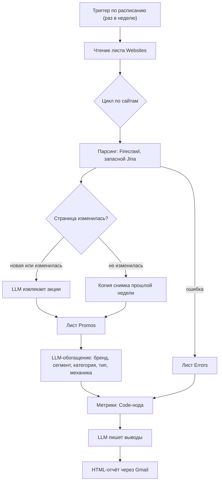

# Competitor Promo Intelligence: AI-агент на n8n для бьюти-ритейла

[English](README.md) | Русский

Еженедельный агент, который следит за страницами акций бьюти-ритейлеров, превращает их в структурированную базу и присылает на почту готовый отчёт по конкурентной разведке. Это пет-проект, сделанный, чтобы показать, что AI-агент может сделать для бренд- или категорийного менеджера.

Проверен на трёх российских ритейлерах (РИВ ГОШ, ЛЭТУАЛЬ, Золотое Яблоко) на двух недельных снимках.

## Что он делает

Каждую неделю агент:

1. **Парсит** страницу акций каждого конкурента и определяет, изменилась ли она с прошлой недели.
2. **Извлекает** акции с изменившихся страниц с помощью LLM (название, скидка, срок, товары).
3. **Обогащает** каждую акцию классификацией: бренд, ценовой сегмент, категория товара, тип акции, механика, длительность.
4. **Формирует отчёт** об изменениях неделя к неделе и отправляет HTML-письмо с таблицами, графиком и текстовыми выводами.

### Что в отчёте

- Главное за период, угрозы и возможности (текст LLM по заранее посчитанным числам)
- KPI неделя к неделе: число акций, новые и завершённые, разбивка по типам
- Оборот акций по конкурентам и структура типов (график)
- Сдвиги механик и глубина скидок
- Бренды, которые продвигают сразу несколько конкурентов
- Блок о качестве данных (доля неопределённых значений)
- Красное предупреждение, если сайт не удалось собрать, с причиной (например, HTTP 403). Такой конкурент исключается из сравнения, чтобы сбой сбора не читался как «все акции закончились»

## Как это работает



### Принятые решения

- **Числа считает код, текст пишет LLM.** Модель получает только JSON с готовыми метриками, и ей запрещено что-либо пересчитывать. Так в отчёте нет арифметических ошибок.
- **Снимок на каждую неделю.** Каждая строка листа `Promos` относится к ISO-неделе (`2026-W44`). Неизменённые страницы копируют строки прошлой недели, поэтому отчёт всегда сравнивает полные снимки.
- **Определение изменений.** Последний текст страницы хранится в n8n Data Table и сравнивается после нормализации пробелов. Неизменённые страницы вообще не доходят до LLM.
- **Обогащение инкрементальное.** В LLM отправляются только строки без классификации.
- **Сбои не останавливают запуск.** Недоступная страница пишется в `Errors`, цикл продолжается, а отчёт показывает, чего не хватает. Отдельный Error Workflow присылает письмо, если упал сам запуск.
- **Стабильные id строк.** `promo_id` создаётся в workflow (неделя плюс хэш содержимого), ручная нумерация не нужна.

## Модель данных

Всё хранится в одном документе Google Sheets и одной таблице n8n Data Table.

| Хранилище | Название | Назначение |
|---|---|---|
| Google Sheet | `Websites` | Список страниц для мониторинга: `company`, `page`, `checked_at`, `changes_log` |
| Google Sheet | `Promos` | Одна строка на акцию в неделю (колонки ниже) |
| Google Sheet | `Errors` | Страницы, которые не удалось собрать: `url`, `httpstatus`, `checked_at`, `title` |
| n8n Data Table | `Competitor websites` | Последний текст страницы по URL: `page`, `content` |

Колонки `Promos`: `promo_id, competitor, date, week, url, title, description, discount, deadline, products, brand, price_segment, product_name, product_category, promotion_type, promotion_mechanic, duration_type, confidence, classification_notes`

### Классификация

| Поле | Значения |
|---|---|
| `promotion_type` | `price`, `gift`, `bundle`, `loyalty`, `service`, `other`, `unknown` |
| `promotion_mechanic` | цена: `brand_discount`, `category_discount`, `kvi`, `threshold`; подарок: `gwp`, `minis`; комплект: `multi-buy`, `BOGO`; лояльность: `promo_code`, `bonus`, `contest` |
| `price_segment` | `luxe`, `premium`, `middle`, `econom`, `unknown` |
| `duration_type` | `short_term` (до 14 дней), `long_term` (более 14 дней), `unknown` |
| `confidence` | `high`, `medium`, `low` |

## Технологии

- [n8n](https://n8n.io) (движок workflow, Data Tables)
- Firecrawl для парсинга, Jina Reader используется как запасной вариант
- Ollama (в workflow используется `gemma4:31b`) для извлечения и классификации
- OpenAI (`gpt-4o`) для текста отчёта; можно заменить любой чат-моделью
- Google Sheets и Gmail
- QuickChart.io для картинки графика в письме

## Установка

### Что нужно

- Инстанс n8n с поддержкой Data Tables
- Аккаунт Google (OAuth для Sheets и Gmail)
- API-ключи Firecrawl, Jina AI, Ollama и OpenAI

### Шаги

1. Создайте документ Google Sheets с тремя листами `Websites`, `Promos` и `Errors` и названиями колонок, как выше.
2. В `Websites` добавьте по строке на страницу: `company` это название конкурента, `page` это адрес страницы с акциями. Не меняйте написание `company`, оно станет значением `competitor`.
3. В n8n создайте Data Table `Competitor websites` с текстовыми колонками `page` и `content`.
4. Импортируйте `competitor_promo_analysis.json` и `error_workflow.json` из корня репозитория.
5. Выберите свои credentials в нодах Google Sheets, Gmail, Firecrawl, Jina, Ollama и OpenAI. В каждой ноде Google Sheets выберите свой документ и нужный лист; в нодах Data Table выберите свою таблицу `Competitor websites`.
6. В основном workflow откройте Settings и выберите импортированный Error Workflow.
7. Укажите получателя отчёта в ноде Gmail и расписание в триггере.
8. Один раз запустите вручную. Для отчёта нужно минимум **два недельных снимка**: при одном он остановится с понятной ошибкой. Запустите ещё раз на следующей неделе.

### Как адаптировать под другие сайты и категории

Добавьте строки в `Websites`. Для другой категории поправьте список категорий и примеры сегментов в промпте классификации (нода `Классификация промо`) и в промпте извлечения (нода `Анализ веб-страниц`). Больше ничего не привязано к косметике.

## Известные ограничения

- **Две недели это слабая база.** Утверждения о трендах предварительные, пока не накопится около четырёх снимков. Для стратегических выводов (куда движется конкурент) нужно 8–12 недель.
- **Единица снимка это неделя.** Запуск workflow дважды в одной ISO-неделе дописывает дубли для изменившихся страниц. Перед повторным запуском удаляйте тестовые строки.
- **Часть сайтов блокирует парсеры** (HTTP 403). Отчёт покажет пропуск, но заполнить его не может.
- **Классификация локальной LLM не идеально стабильна.** Одна и та же акция может получить немного другую разметку на следующей неделе, чаще всего в `product_category`.
- **«Глубина скидки» смешивает разные вещи.** «До −60%» это потолок для категории, а не фиксированная скидка, поэтому средние по конкурентам читайте с осторожностью.

## Структура репозитория

```
.
├── README.md
├── README.ru.md
├── competitor_promo_analysis.json
├── error_workflow.json
├── LICENSE
└── .gitignore
```

## Перед публикацией своей копии

Из экспортов workflow в этом репозитории удалены личные ID и адреса почты. Перед импортом выберите в n8n свои ресурсы вместо placeholders `YOUR_GOOGLE_SHEETS_DOCUMENT_ID`, `YOUR_N8N_DATA_TABLE_ID` и `YOUR_N8N_PROJECT_ID`. Перед публикацией изменений проверьте JSON на личные адреса, ссылки на документы, ID credentials и метаданные инстанса.

## Ответственное использование

Парсинг может быть ограничен условиями использования сайта и `robots.txt`. Проверьте их, держите низкую частоту запросов (workflow делает паузы между страницами) и используйте данные только для анализа. Названия ритейлеров используются для идентификации и принадлежат их владельцам; проект с ними не связан.

## Лицензия

Проект распространяется по лицензии [MIT](LICENSE).
